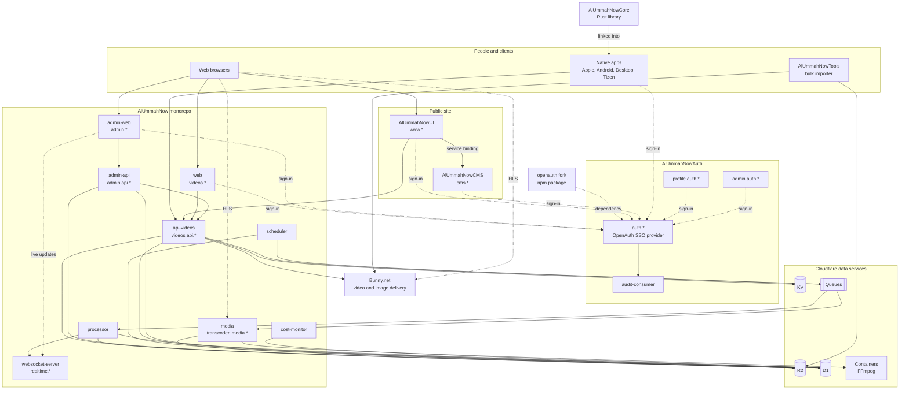

# Al Ummah Now Wiki

Al Ummah Now (الأمة الآن) is an Islamic video and community platform, available in English and Arabic (RTL throughout). It has a public website, a video site, a single sign-on service, a content management system and native apps for phones, TVs and desktops.

This wiki explains how the [Al-Ummah-Now](https://github.com/Al-Ummah-Now) repositories fit together. It links to the source instead of copying it. If a page and the code disagree, the code wins, and a fix to the page is welcome.

Facts here were first read from each repo's default branch on 2026-11-09 and brought up to date on 2026-11-12. "Current state" sections are snapshots from the date in their heading. What changed is in the [changelog](guides/changelog.md). Anything that couldn't be confirmed is marked **Unverified**.

## Index

**Repositories**

| Page | What it is |
|---|---|
| [AlUmmahNow](repos/AlUmmahNow.md) | Monorepo: videos web, APIs, processor, realtime, scheduler, admin |
| [AlUmmahNowAuth](repos/AlUmmahNowAuth.md) | SSO provider, account profile, auth admin, audit consumer |
| [openauth](repos/openauth.md) | Fork of OpenAuth used by the auth service |
| [AlUmmahNowUI](repos/AlUmmahNowUI.md) | Public website (www) |
| [AlUmmahNowCMS](repos/AlUmmahNowCMS.md) | Staff content admin for www |
| [AlUmmahNowCore](repos/AlUmmahNowCore.md) | Shared Rust core for the native apps |
| [AlUmmahNowApple](repos/AlUmmahNowApple.md) | iOS, iPadOS, tvOS and macOS apps |
| [AlUmmahNowAndroid](repos/AlUmmahNowAndroid.md) | Android phone, tablet, TV, Fire TV and Auto apps |
| [AlUmmahNowDesktop](repos/AlUmmahNowDesktop.md) | Windows, Linux and Samsung Tizen apps |
| [AlUmmahNowTools](repos/AlUmmahNowTools.md) | Bulk video importer and related .NET tools |

**Guides**

| Page | Covers |
|---|---|
| [Environments and domains](guides/environments.md) | QA, stage and production hostnames |
| [Release process](guides/release-process.md) | How each repo reaches production |
| [Testing and E2E](guides/testing.md) | Local E2E stack, placement, own data, leftover checks, cleanup jobs |
| [Video delivery](guides/video-delivery.md) | Bunny and R2 side by side, playback source, signed URLs, libraries and collections |
| [Deletion, erasure and cleanup](guides/data-lifecycle.md) | Soft delete and the 30-day purge, account erasure, scheduled cleanup |
| [Contributing](guides/contributing.md) | Branches, PRs, tests, migrations, spec → plan → implement |
| [Authentication and SSO](guides/authentication.md) | How sign-in works across the apps |
| [Site roles and channel roles](guides/roles.md) | Two separate permission systems |
| [Theming](guides/theming.md) | Lantern, Zujaj, Nahas and Fawanees |
| [Copy Tone Guide](guides/copy-tone.md) | How UI text reads in English and Arabic: content sharing, not a lecture library |
| [Specs index](guides/specs-index.md) | Every spec in the monorepo, with status |
| [Changelog](guides/changelog.md) | What changed across the repos, by date and feature |

**Epics and decisions**

| Page | Covers |
|---|---|
| [Epics](epics/README.md) | Every epic in every repo, shipped to rejected, with sources |
| [Decision log](epics/decisions.md) | Owner decisions (D1–D11 and others), with status and what each blocks |
| [Glossary](guides/glossary.md) | Terms used across the project |

## System map

Everything server-side runs on Cloudflare Workers. Hostnames for each environment are in [Environments and domains](guides/environments.md).

## How the pieces work together

- **Identity.** [AlUmmahNowAuth](repos/AlUmmahNowAuth.md) is the only sign-in service. Every app is one of its OAuth clients, and it knows nothing about the apps: apps depend on auth, never the reverse. See [Authentication and SSO](guides/authentication.md).
- **Videos.** The [monorepo](repos/AlUmmahNow.md) holds the videos product. `api-videos` stores metadata in R2 and D1, talks to Bunny.net for streaming and images, and sends events to Cloudflare Queues. `processor` consumes those queues and `websocket-server` delivers live updates, including to the admin pages. `media` transcodes every upload into R2 on Cloudflare Containers, and the API picks Bunny or R2 for each play ([Video delivery](guides/video-delivery.md)). `admin-web` and `admin-api` are the staff tools; `cost-monitor` collects platform analytics for them.
- **Public site.** [AlUmmahNowUI](repos/AlUmmahNowUI.md) serves `www`, with editorial content from [AlUmmahNowCMS](repos/AlUmmahNowCMS.md) and video data from `api-videos`.
- **Native apps.** [Apple](repos/AlUmmahNowApple.md), [Android](repos/AlUmmahNowAndroid.md) and [Desktop](repos/AlUmmahNowDesktop.md) use native UI and players. Shared logic is moving into [AlUmmahNowCore](repos/AlUmmahNowCore.md).
- **Content import.** [AlUmmahNowTools](repos/AlUmmahNowTools.md) is a .NET tool set for bulk uploads to Bunny.net and R2.

## Reporting a problem

Open an issue in the repo concerned. For a security problem, don't open a public issue: use **Security → Report a vulnerability** in that repo, as its `SECURITY.md` describes ([example](https://github.com/Al-Ummah-Now/AlUmmahNow/blob/main/SECURITY.md)).

To improve this wiki, open a pull request. Links are checked in CI, so a broken link fails the PR.
