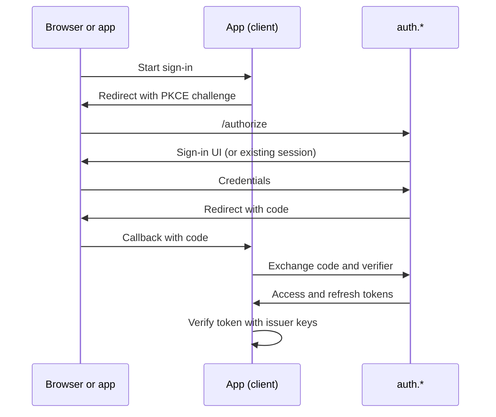

[← Home](../README.md)

# Authentication and SSO

[AlUmmahNowAuth](../repos/AlUmmahNowAuth.md) is the single sign-on provider for every Al Ummah Now app. It's built on the [openauth fork](../repos/openauth.md) and runs at `auth.*`.

## Design rule: auth depends on no app

Apps depend on auth, never the reverse. Auth and the account hub don't call an app's API, read its data or import its code. When an app needs to react to something in auth, such as a deleted account, the design is for auth to publish an event that subscribed apps handle themselves. See [the account hub spec](https://github.com/Al-Ummah-Now/AlUmmahNowAuth/blob/main/docs/account-hub/SPEC.md#0-architectural-rule-auth-depends-on-no-app).

## Components

| Part | Host | Role |
|---|---|---|
| Issuer (`apps/auth`) | `auth.*` | OAuth 2.0 / OIDC provider, sign-in UI, session APIs |
| Profile (`apps/profile`) | `profile.auth.*` | The user's account page, an OAuth client |
| Auth admin (`apps/admin`) | `admin.auth.*` | User and client administration |
| Audit consumer | None | Writes audit events from a queue |

Hosts per environment are in [Environments and domains](environments.md).

## Signing in

- The issuer's sign-in uses OpenAuth's password provider, with email codes sent through Resend. Older docs such as `AUTHENTICATION_FLOWS.md` describe it as purely passwordless, so prefer [`apps/auth/src/index.ts`](https://github.com/Al-Ummah-Now/AlUmmahNowAuth/blob/main/apps/auth/src/index.ts).
- `www` and the CMS are public clients using PKCE. See their [www](https://github.com/Al-Ummah-Now/AlUmmahNowUI/blob/main/README.md#how-it-works) and [CMS](https://github.com/Al-Ummah-Now/AlUmmahNowCMS/blob/main/README.md#access) docs. PKCE on the profile app's own redirect is tracked in [#251](https://github.com/Al-Ummah-Now/AlUmmahNowAuth/issues/251).
- Native clients and the device authorization grant for TVs come from the openauth fork ([#18](https://github.com/Al-Ummah-Now/openauth/pull/18), [#19](https://github.com/Al-Ummah-Now/openauth/pull/19)).

## Tokens

- Access tokens are JWTs carrying the user's identity and a `roles` array. They last 15 minutes on production and stage ([#244](https://github.com/Al-Ummah-Now/AlUmmahNowAuth/pull/244)).
- Apps verify tokens against their environment's issuer. Stage has its own issuer and signing keys.
- Revoked sessions are published to a KV namespace that the videos services read.
- **Tokens hold site roles only.** Channel roles are never put in a token. See [Site roles and channel roles](roles.md).

## Sessions and multiple accounts

The auth host keeps a browser session that can hold several accounts, with APIs to list and switch them and an account picker for `prompt=select_account`. Code is in [`apps/auth/src/routes`](https://github.com/Al-Ummah-Now/AlUmmahNowAuth/tree/main/apps/auth/src/routes).

Each app also keeps its own session. For example, `www` stores a short encrypted cookie and no tokens.

## SSO work in progress (2026-11-09)

"Signed in once means signed in everywhere" is being rolled out across clients:

- Monorepo: [#463](https://github.com/Al-Ummah-Now/AlUmmahNow/pull/463)
- Auth: [#254](https://github.com/Al-Ummah-Now/AlUmmahNowAuth/pull/254)
- www: [#14](https://github.com/Al-Ummah-Now/AlUmmahNowUI/pull/14)
- CMS: [#20](https://github.com/Al-Ummah-Now/AlUmmahNowCMS/pull/20)
- Core: [#22](https://github.com/Al-Ummah-Now/AlUmmahNowCore/pull/22)
- Android: [#5](https://github.com/Al-Ummah-Now/AlUmmahNowAndroid/issues/5)
- Desktop: [#21](https://github.com/Al-Ummah-Now/AlUmmahNowDesktop/issues/21)

The account hub, which turns the profile app into one place to manage an account, is specified but not built: [spec](https://github.com/Al-Ummah-Now/AlUmmahNowAuth/blob/main/docs/account-hub/SPEC.md), [plan](https://github.com/Al-Ummah-Now/AlUmmahNowAuth/blob/main/docs/account-hub/PLAN.md).

## Integrating a new app

Start with the [client integration guide](https://github.com/Al-Ummah-Now/AlUmmahNowAuth/blob/main/docs/plans/CLIENT-INTEGRATION-GUIDE.md) and [SDK usage](https://github.com/Al-Ummah-Now/AlUmmahNowAuth/blob/main/SDK_USAGE.md).
