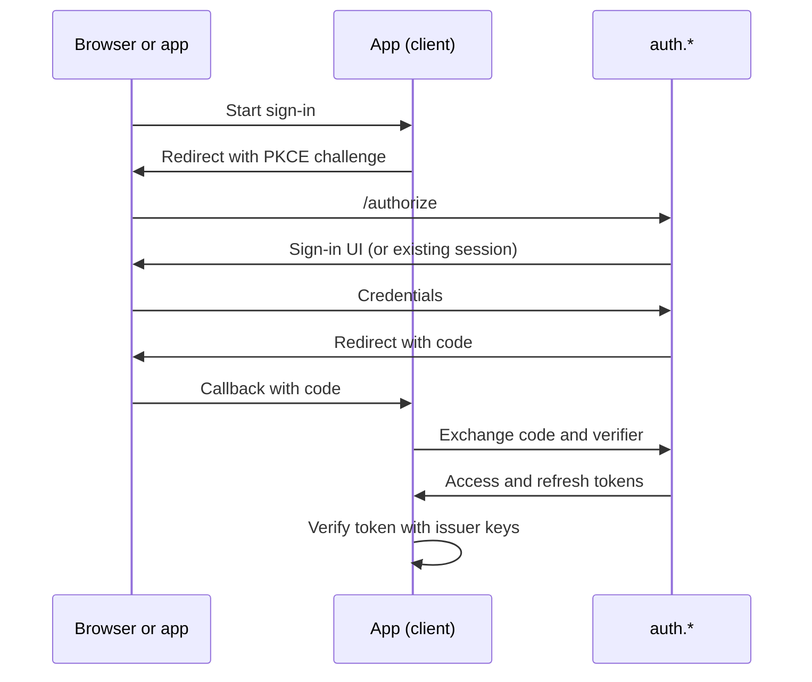

[← Home](../README.md)

# Authentication and SSO

[AlUmmahNowAuth](../repos/AlUmmahNowAuth.md) is the single sign-on provider for every Al Ummah Now app. It's built on the [openauth fork](../repos/openauth.md) and runs at `auth.*`.

## Design rule: auth depends on no app

Apps depend on auth, never the reverse. Auth and the account hub don't call an app's API, read its data or import its code. When an app needs to react to something in auth, such as a deleted account, the design is for auth to publish an event that subscribed apps handle themselves. See [the account hub spec](https://github.com/Al-Ummah-Now/AlUmmahNowAuth/blob/main/docs/account-hub/SPEC.md#0-architectural-rule-auth-depends-on-no-app).

## Components

| Part | Host | Role |
|---|---|---|
| Issuer (`apps/auth`) | `auth.*` | OAuth 2.0 / OIDC provider, sign-in UI, session APIs |
| Profile (`apps/profile`) | `profile.auth.*` | The user's account page, an OAuth client |
| Auth admin (`apps/admin`) | `admin.auth.*` | Users, clients, roles, moderation requests, sign-in themes and recently deleted items |
| Audit consumer | None | Writes audit events from a queue |

Hosts per environment are in [Environments and domains](environments.md).

## Signing in

- The issuer's sign-in uses OpenAuth's password provider, with email codes sent through Resend. Older docs such as `AUTHENTICATION_FLOWS.md` describe it as purely passwordless, so prefer [`apps/auth/src/index.ts`](https://github.com/Al-Ummah-Now/AlUmmahNowAuth/blob/main/apps/auth/src/index.ts).
- **PKCE (S256) is required for every first-party web client**: videos web, videos admin, www, the CMS, profile and auth admin. The issuer refuses their codes without the verifier. The list is [`pkce-clients.ts`](https://github.com/Al-Ummah-Now/AlUmmahNowAuth/blob/main/apps/auth/src/pkce-clients.ts) ([Auth#276](https://github.com/Al-Ummah-Now/AlUmmahNowAuth/pull/276), [Auth#283](https://github.com/Al-Ummah-Now/AlUmmahNowAuth/pull/283), [Auth#302](https://github.com/Al-Ummah-Now/AlUmmahNowAuth/pull/302), [openauth#28](https://github.com/Al-Ummah-Now/openauth/pull/28), [AlUmmahNow#559](https://github.com/Al-Ummah-Now/AlUmmahNow/pull/559)).
- Authorization codes are single-use across workers, and refresh tokens rotate in an atomic D1 store. Reusing an old refresh token revokes only that token family ([Auth#266](https://github.com/Al-Ummah-Now/AlUmmahNowAuth/pull/266)).
- Native clients and the device authorization grant for TVs come from the openauth fork ([#18](https://github.com/Al-Ummah-Now/openauth/pull/18), [#19](https://github.com/Al-Ummah-Now/openauth/pull/19)).
- Sign-in and profile pages are in English unless the link has `?lang=ar`. They follow the site-wide theme, Fawanees by default. See [Theming](theming.md).

### Limits and refusals

- Rate limits use the Workers Rate Limiting binding, not KV ([`rate-limit.ts`](https://github.com/Al-Ummah-Now/AlUmmahNowAuth/blob/main/apps/auth/src/rate-limit.ts), [Auth#268](https://github.com/Al-Ummah-Now/AlUmmahNowAuth/pull/268)).
- Email codes and password sign-in have attempt limits kept in D1 ([Auth#264](https://github.com/Al-Ummah-Now/AlUmmahNowAuth/pull/264)).
- Suspended, deleted and not-yet-claimed invited accounts get no tokens by any route: sign-in, code exchange, device grant or refresh. The check reads D1 ([`account-status.ts`](https://github.com/Al-Ummah-Now/AlUmmahNowAuth/blob/main/apps/auth/src/security/account-status.ts), [Auth#285](https://github.com/Al-Ummah-Now/AlUmmahNowAuth/pull/285)).

## Tokens

- Access tokens are JWTs carrying the user's identity and a `roles` array. They last 15 minutes on production and stage ([#244](https://github.com/Al-Ummah-Now/AlUmmahNowAuth/pull/244)). A refreshed token carries the user's current roles ([Auth#284](https://github.com/Al-Ummah-Now/AlUmmahNowAuth/pull/284)).
- Apps verify tokens against their environment's issuer. Stage has its own issuer and signing keys. The JWKS and discovery documents are edge-cached, and the last good copy is served if D1 stalls ([`well-known-cache.ts`](https://github.com/Al-Ummah-Now/AlUmmahNowAuth/blob/main/apps/auth/src/well-known-cache.ts), [Auth#333](https://github.com/Al-Ummah-Now/AlUmmahNowAuth/pull/333)).
- Revocations ("sign out everywhere", password change, suspend, delete) are written to D1 and to a KV namespace. The issuer's refresh check reads D1, which is current everywhere. The videos services read the KV copy for their short-lived access tokens ([`revocation-list.ts`](https://github.com/Al-Ummah-Now/AlUmmahNowAuth/blob/main/apps/auth/src/revocation/revocation-list.ts), [Auth#288](https://github.com/Al-Ummah-Now/AlUmmahNowAuth/pull/288)).
- The videos APIs reject legacy 30-day access tokens, so clients refresh ([AlUmmahNow#666](https://github.com/Al-Ummah-Now/AlUmmahNow/pull/666)).
- **Tokens hold site roles only.** Channel roles are never put in a token. See [Site roles and channel roles](roles.md).

## Sessions and multiple accounts

The auth host keeps a browser session that can hold several accounts, with APIs to list and switch them and an account picker for `prompt=select_account`. Code is in [`apps/auth/src/routes`](https://github.com/Al-Ummah-Now/AlUmmahNowAuth/tree/main/apps/auth/src/routes). The `__session` cookie is `Secure`, except on a localhost issuer, where WebKit would drop it ([Auth#336](https://github.com/Al-Ummah-Now/AlUmmahNowAuth/pull/336), [openauth#41](https://github.com/Al-Ummah-Now/openauth/pull/41)).

Each app also keeps its own session. For example, `www` stores a short encrypted cookie and no tokens. Profile and auth admin keep their sessions in D1 and allow one refresh per session at a time, so parallel tabs can't trip refresh-token reuse detection ([Auth#286](https://github.com/Al-Ummah-Now/AlUmmahNowAuth/pull/286), [Auth#287](https://github.com/Al-Ummah-Now/AlUmmahNowAuth/pull/287)).

Signing out walks every app's front-channel logout and revokes the refresh tokens ([AlUmmahNow#718](https://github.com/Al-Ummah-Now/AlUmmahNow/pull/718)). A password change or admin reset also ends the user's browser sign-ins ([Auth#265](https://github.com/Al-Ummah-Now/AlUmmahNowAuth/pull/265)).

## Accounts managed by admins

- **Invites.** An app admin can invite someone by email. The account exists at once, so the app can set it up, and the person's first sign-in with that email claims it. See [USER_INVITES.md](https://github.com/Al-Ummah-Now/AlUmmahNowAuth/blob/main/docs/USER_INVITES.md) ([Auth#299](https://github.com/Al-Ummah-Now/AlUmmahNowAuth/pull/299)).
- **Moderation requests.** A client app (today the videos admin) can ask for an action on an auth account, such as suspend or delete. Only auth admins decide, in the auth admin's queue. Approved actions run from a queue with retries. See [MODERATION_REQUESTS.md](https://github.com/Al-Ummah-Now/AlUmmahNowAuth/blob/main/docs/MODERATION_REQUESTS.md) ([Auth#275](https://github.com/Al-Ummah-Now/AlUmmahNowAuth/pull/275), [Auth#278](https://github.com/Al-Ummah-Now/AlUmmahNowAuth/pull/278)).
- **Soft delete.** Admin deletes of users, clients, roles and themes can be restored for 30 days. An hourly cleanup then purges them, or sooner if an admin asks for permanent deletion ([Auth#293](https://github.com/Al-Ummah-Now/AlUmmahNowAuth/pull/293)). A purge also removes the email-to-subject record and invite rows ([Auth#326](https://github.com/Al-Ummah-Now/AlUmmahNowAuth/pull/326), [Auth#335](https://github.com/Al-Ummah-Now/AlUmmahNowAuth/pull/335)).
- **E2E run accounts.** CI runs register their own `e2e+<run>-…@e2e.alummahnow.net` accounts and delete them at the end, through teardown routes that exist only on QA and stage ([`test-run-users.ts`](https://github.com/Al-Ummah-Now/AlUmmahNowAuth/blob/main/apps/auth/src/routes/test-run-users.ts), [Auth#303](https://github.com/Al-Ummah-Now/AlUmmahNowAuth/pull/303)).

## Current state (2026-11-12)

"Signed in once means signed in everywhere" is live on every web client, and the SSO hardening from the 2026-11-10 audit is merged (see the [epic](../epics/CHAT-SSO-sso-everywhere.md)). Core's part is merged ([Core#22](https://github.com/Al-Ummah-Now/AlUmmahNowCore/pull/22)). Native clients still track it in [Android#5](https://github.com/Al-Ummah-Now/AlUmmahNowAndroid/issues/5) and [Desktop#21](https://github.com/Al-Ummah-Now/AlUmmahNowDesktop/issues/21).

Open in the auth repo: native sign-out from an app's browser session ([#310](https://github.com/Al-Ummah-Now/AlUmmahNowAuth/issues/310)), email addresses in sign-in logs ([#313](https://github.com/Al-Ummah-Now/AlUmmahNowAuth/issues/313)), round trips per sign-in in the fork ([#314](https://github.com/Al-Ummah-Now/AlUmmahNowAuth/issues/314)), and telling apps when a user is purged ([#291](https://github.com/Al-Ummah-Now/AlUmmahNowAuth/issues/291)).

The account hub is still mostly unbuilt beyond the `account.*` redirect: [spec](https://github.com/Al-Ummah-Now/AlUmmahNowAuth/blob/main/docs/account-hub/SPEC.md), [plan](https://github.com/Al-Ummah-Now/AlUmmahNowAuth/blob/main/docs/account-hub/PLAN.md).

## Integrating a new app

Start with the [client integration guide](https://github.com/Al-Ummah-Now/AlUmmahNowAuth/blob/main/docs/plans/CLIENT-INTEGRATION-GUIDE.md) and [SDK usage](https://github.com/Al-Ummah-Now/AlUmmahNowAuth/blob/main/SDK_USAGE.md).
