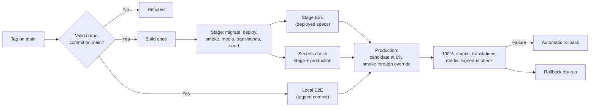

[← Home](../README.md)

# Release process

**There are no hand deploys.** Stage and production are released only by CI. If CI blocks a release, fix CI in a pull request.

| Repo | QA | Production trigger |
|---|---|---|
| [AlUmmahNow](../repos/AlUmmahNow.md) | Push to `main` | `vYYYY.MM.DD[.N]` tag on `main` |
| [AlUmmahNowUI](../repos/AlUmmahNowUI.md) | Push to `main` | `vYYYY.MM.DD[.N]` tag on `main` |
| [AlUmmahNowCMS](../repos/AlUmmahNowCMS.md) | Push to `main` | `vYYYY.MM.DD[.N]` tag on `main` |
| [AlUmmahNowAuth](../repos/AlUmmahNowAuth.md) | From PRs | Every merge to `main` |
| [openauth](../repos/openauth.md) | Not applicable | Merge to `master` publishes to GitHub Packages once tests pass; the version comes from git tags, never a pushed commit ([openauth#27](https://github.com/Al-Ummah-Now/openauth/pull/27)) |
| [AlUmmahNowCore](../repos/AlUmmahNowCore.md) | Not applicable | `vX.Y.Z` (or `vX.Y.Z-rc.N` pre-release) tag on `main`, matching `Cargo.toml`, publishes the AAR, NuGet, XCFramework and a SwiftPM tag |
| [AlUmmahNowAndroid](../repos/AlUmmahNowAndroid.md) | QA build flavour | `vYYYY.MM.DD[.N]` tag on `main`: Studio APKs and AAB on a GitHub release (pre-release key until the upload key exists); Play internal once its inputs are set ([Android#10](https://github.com/Al-Ummah-Now/AlUmmahNowAndroid/pull/10)) |
| [AlUmmahNowDesktop](../repos/AlUmmahNowDesktop.md) | QA build default; `vX.Y.Z-<suffix>` tag publishes a QA pre-release | `vX.Y.Z` tag creates a draft release (MSI, portable zip, `.deb`, Flatpak, Tizen) that a person publishes ([Desktop#27](https://github.com/Al-Ummah-Now/AlUmmahNowDesktop/pull/27)) |
| [AlUmmahNowApple](../repos/AlUmmahNowApple.md) | QA build | `vX.Y.Z` tag on `main`: notarized Studio Mac downloads on a GitHub release and iOS/iPadOS to TestFlight ([Apple#19](https://github.com/Al-Ummah-Now/AlUmmahNowApple/pull/19)); no release cut yet |
| [AlUmmahNowTools](../repos/AlUmmahNowTools.md) | Not applicable | No release workflow; CI runs tests only |

## AlUmmahNow, www and CMS: tag releases

Merging to `main` deploys QA only. Production moves only when someone pushes a release tag.

```sh
git fetch origin --tags
TAG=$(pnpm -s release:tag next)    # monorepo: today's US Eastern date, next free number
git tag -a "$TAG" origin/main -m "Release $TAG"
git push origin "$TAG"
```

Tags are `vYYYY.MM.DD`, and a later release the same day is `vYYYY.MM.DD.N` with N from 2 (for example `v2026.11.12.9`). **The date is the US Eastern date (America/New_York), never UTC** (owner, 2026-11-12): at 20:58 ET on 12 November, which is 01:58 UTC on 13 November, the next tag is `v2026.11.12.10`, not `v2026.11.13`. In the monorepo, `pnpm release:tag next` prints the next free tag ([#1104](https://github.com/Al-Ummah-Now/AlUmmahNow/pull/1104)); the same date rule applies to the www and CMS tags. In the monorepo, tag a commit only after its `deploy.yml` run and QA deploy are green. Releases are cut from green `main` often, several a day.



### The monorepo's release gates

Production waits for all of these ([`release.yml`](https://github.com/Al-Ummah-Now/AlUmmahNow/blob/main/.github/workflows/release.yml)):

- **Stage** deploy, migrations and smoke.
- **Stage E2E:** the release suite's deployed specs on stage.
- **Local E2E:** every spec placed `local`, on the tagged commit, each job on its own local stack ([#1050](https://github.com/Al-Ummah-Now/AlUmmahNow/pull/1050)). See [Testing and E2E](testing.md).
- **Secrets checks** of stage and production: every worker has its required secrets and no test-only secret is in production. Names only, never values.

Load and timing specs (`@load`) run in releases but never block one ([#952](https://github.com/Al-Ummah-Now/AlUmmahNow/pull/952)). Encode-waiting specs run in their own step under a 2-slot lock, and a slow third-party encode skips rather than fails.

The repository variable `RELEASE_SKIP_STAGE_E2E` is an emergency override: while it is `true`, a failed stage E2E doesn't block production. Everything else still gates. Use it only with the owner's OK and unset it afterwards ([#690](https://github.com/Al-Ummah-Now/AlUmmahNow/pull/690)).

### What else a release does

- **Media.** Stage and production deploy the `apps/media` Worker and transcoder container after the other apps, run a media smoke, and roll the media Worker back if it fails. The media CDN settings are applied as code. See [Video delivery](video-delivery.md).
- **Queue consumers** are registered by a script, because promoting a version never registers them.
- **Cost monitor** is deployed to stage and production.
- **Translation store sync.** Every deploy (QA, stage and production) syncs the stored translations with the repo, then checks them. Repo text wins for every key an admin hasn't edited; admin-edited keys (listed as `overrides`) are kept; removed keys are dropped; missing files are seeded ([#999](https://github.com/Al-Ummah-Now/AlUmmahNow/pull/999), [#1005](https://github.com/Al-Ummah-Now/AlUmmahNow/pull/1005)).
- **Production signed-in check** with throwaway test accounts, which are then deleted. A check that production holds no test data follows ([#527](https://github.com/Al-Ummah-Now/AlUmmahNow/pull/527), [#565](https://github.com/Al-Ummah-Now/AlUmmahNow/pull/565)).
- **Rollback dry run** after every production promote: it resolves each worker's rollback target without moving traffic ([#692](https://github.com/Al-Ummah-Now/AlUmmahNow/pull/692)).
- **Skew protection.** Pages open during a deploy keep working: they can reach the old version ([#583](https://github.com/Al-Ummah-Now/AlUmmahNow/pull/583), [#620](https://github.com/Al-Ummah-Now/AlUmmahNow/pull/620)).

### Rules

- Running `release.yml` by hand on `main` releases to **stage only**. It never touches production.
- **Never move or delete a tag.** To retry after a transient failure (a flaky Cloudflare call, a cold preview URL, a third-party outage), **re-run that tag's workflow run**, or only its failed jobs. A real failure is fixed on `main` and released with a new tag.
- Releases queue one at a time. GitHub keeps only the newest pending run, so if two tags are pushed while a release is running, only the later one is released.
- To undo a release, run `rollback.yml`, fix forward on `main`, and tag again.
- Database migrations are expand-only and run before new code takes traffic.

Sources: [monorepo deploy rules](https://github.com/Al-Ummah-Now/AlUmmahNow/blob/main/CLAUDE.md#deploy-rules), [release pipeline spec](https://github.com/Al-Ummah-Now/AlUmmahNow/blob/main/docs/release-pipeline/SPEC.md), [`release.yml`](https://github.com/Al-Ummah-Now/AlUmmahNow/blob/main/.github/workflows/release.yml).

Between releases, the monorepo's PR checks include Local E2E and the release suite's deployed specs against QA.

### www and CMS

[AlUmmahNowUI](../repos/AlUmmahNowUI.md) and [AlUmmahNowCMS](../repos/AlUmmahNowCMS.md) follow the same tag rule and the same stage → production shape. Their release waits until the new candidate answers three times in a row before the smoke runs ([UI#28](https://github.com/Al-Ummah-Now/AlUmmahNowUI/pull/28), [CMS#49](https://github.com/Al-Ummah-Now/AlUmmahNowCMS/pull/49)), and www retries a versions deploy while Cloudflare can't yet see the uploaded version ([UI#16](https://github.com/Al-Ummah-Now/AlUmmahNowUI/pull/16)).

## AlUmmahNowAuth: release on merge

PRs deploy to QA and run E2E there. **Every merge to `main`** runs `release.yml`: build once, stage, smoke and E2E on stage, then production through the same 0% → smoke → 100% promotion, with automatic rollback.

A failed stage job stops the release and leaves production untouched.

The audit consumer has no gradual rollout and is left out of `rollback.yml` on purpose. Details are in [the auth release notes](https://github.com/Al-Ummah-Now/AlUmmahNowAuth/blob/main/docs/release-pipeline.md).

Switching auth to tag releases is proposed in [#217](https://github.com/Al-Ummah-Now/AlUmmahNowAuth/issues/217).

Every released Auth commit also publishes a **local-stack bundle** (the prebuilt auth, profile and admin workers, configs and migrations) on a `local-stack-<sha>` prerelease, which the monorepo's local E2E stack runs ([Auth#323](https://github.com/Al-Ummah-Now/AlUmmahNowAuth/pull/323), [Auth#324](https://github.com/Al-Ummah-Now/AlUmmahNowAuth/pull/324)). QA deploys are serialised with a waiting lock rather than a concurrency group ([Auth#306](https://github.com/Al-Ummah-Now/AlUmmahNowAuth/pull/306)).

## Libraries and native apps

Each repo's page describes its pipeline. The common rule is that nothing goes to a package registry or app store by hand.

## Older instructions

Some older documents describe manual deploys or the `deploy-production` job in `deploy.yml`. That job is superseded and not used. Follow this page and the deploy rules linked above.
