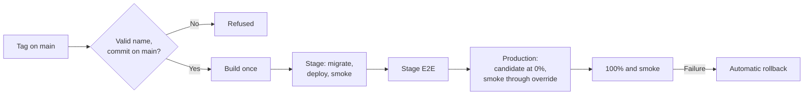

[← Home](../README.md)

# Release process

**There are no hand deploys.** Stage and production are released only by CI. If CI blocks a release, fix CI in a pull request.

| Repo | QA | Production trigger |
|---|---|---|
| [AlUmmahNow](../repos/AlUmmahNow.md) | Push to `main` | `vYYYY.MM.DD` tag on `main` |
| [AlUmmahNowUI](../repos/AlUmmahNowUI.md) | Push to `main` | `vYYYY.MM.DD` tag on `main` |
| [AlUmmahNowCMS](../repos/AlUmmahNowCMS.md) | Push to `main` | `vYYYY.MM.DD` tag on `main` |
| [AlUmmahNowAuth](../repos/AlUmmahNowAuth.md) | From PRs | Every merge to `main` |
| [openauth](../repos/openauth.md) | Not applicable | Push to `master` publishes a package |
| [AlUmmahNowCore](../repos/AlUmmahNowCore.md) | Not applicable | `vX.Y.Z` tag on `main` publishes packages |
| [AlUmmahNowAndroid](../repos/AlUmmahNowAndroid.md) | QA build flavour | `vYYYY.MM.DD[.N]` tag to the Play internal track; signing inputs pending |
| [AlUmmahNowDesktop](../repos/AlUmmahNowDesktop.md) | QA build default | `vX.Y.Z` tag creates a draft GitHub release |
| [AlUmmahNowApple](../repos/AlUmmahNowApple.md) | QA build | No release workflow yet ([#5](https://github.com/Al-Ummah-Now/AlUmmahNowApple/issues/5)) |
| [AlUmmahNowTools](../repos/AlUmmahNowTools.md) | Not applicable | No release workflow |

## AlUmmahNow, www and CMS: tag releases

Merging to `main` deploys QA only. Production moves only when someone pushes a release tag.

```sh
git fetch origin
git tag -a v2026.11.08 origin/main -m "Release v2026.11.08"
git push origin v2026.11.08
```

A second release on the same day uses `vYYYY.MM.DD.2`, and so on. In the monorepo, tag a commit only after its `deploy.yml` run and QA deploy are green.



- Running `release.yml` by hand on `main` releases to **stage only**. It never touches production.
- Never move or delete a tag. To retry after a transient failure, re-run that tag's workflow run.
- To undo a release, run `rollback.yml`, fix forward on `main`, and tag again.
- Database migrations are expand-only and run before new code takes traffic.

Sources: [monorepo deploy rules](https://github.com/Al-Ummah-Now/AlUmmahNow/blob/main/CLAUDE.md#deploy-rules), [release pipeline spec](https://github.com/Al-Ummah-Now/AlUmmahNow/blob/main/docs/release-pipeline/SPEC.md), [`release.yml`](https://github.com/Al-Ummah-Now/AlUmmahNow/blob/main/.github/workflows/release.yml).

Between releases, the monorepo's PR checks include the release E2E suite against QA.

## AlUmmahNowAuth: release on merge

PRs deploy to QA and run E2E there. **Every merge to `main`** runs `release.yml`: build once, stage, smoke and E2E on stage, then production through the same 0% → smoke → 100% promotion, with automatic rollback.

A failed stage job stops the release and leaves production untouched.

The audit consumer has no gradual rollout and is left out of `rollback.yml` on purpose. Details are in [the auth release notes](https://github.com/Al-Ummah-Now/AlUmmahNowAuth/blob/main/docs/release-pipeline.md).

Switching auth to tag releases is proposed in [#217](https://github.com/Al-Ummah-Now/AlUmmahNowAuth/issues/217).

## Libraries and native apps

Each repo's page describes its pipeline. The common rule is that nothing goes to a package registry or app store by hand.

## Older instructions

Some older documents describe manual deploys or the `deploy-production` job in `deploy.yml`. That job is superseded and not used. Follow this page and the deploy rules linked above.
