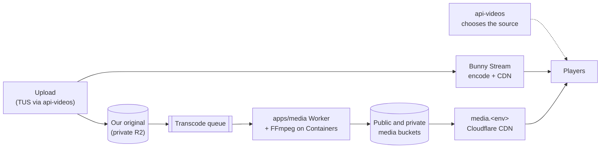

[← Home](../README.md)

# Video delivery

How a video gets from an upload to a viewer's player: Bunny Stream, the R2 + Cloudflare CDN path beside it, which one a play uses, and how URLs are signed. Read from [AlUmmahNow](../repos/AlUmmahNow.md) `main` on 2026-11-12.

Sources in the monorepo: [media delivery runbook](https://github.com/Al-Ummah-Now/AlUmmahNow/blob/main/docs/media-delivery/RUNBOOK.md), [R2 delivery plan](https://github.com/Al-Ummah-Now/AlUmmahNow/blob/main/docs/media-delivery/R2-DELIVERY-PLAN.md), [keeping our own originals](https://github.com/Al-Ummah-Now/AlUmmahNow/blob/main/docs/media-delivery/ORIGINALS.md) and [Bunny libraries and collections](https://github.com/Al-Ummah-Now/AlUmmahNow/blob/main/docs/operations/bunny-libraries.md). Background: decision [D2](../epics/D2-video-delivery.md) and epic [AUN-R2-MIGRATION](../epics/AUN-R2-MIGRATION-r2-video-migration.md).

## Two sources, side by side

Every upload goes to **Bunny Stream**, as before, and is also **transcoded into R2** and served through Cloudflare's CDN on `media.<env>.alummahnow.net` ([#893](https://github.com/Al-Ummah-Now/AlUmmahNow/pull/893), [#894](https://github.com/Al-Ummah-Now/AlUmmahNow/pull/894)). The owner chose to run both side by side before switching ([O32](../epics/decisions.md#o32-run-bunny-and-r2-side-by-side-before-switching)). R2 delivery is live on QA, stage and production since release `v2026.11.12.3` ([#948](https://github.com/Al-Ummah-Now/AlUmmahNow/pull/948)).

- **Transcoder.** `apps/media` is a queue consumer that runs FFmpeg in Cloudflare Containers and writes HLS renditions to R2. Private videos are served from the private bucket through the Worker's `/priv/*` route with a path token; public ones from the public bucket through the CDN.
- **Originals.** We keep our own copy of the upload, so R2 transcodes start at upload and no longer wait for Bunny ([#972](https://github.com/Al-Ummah-Now/AlUmmahNow/pull/972)). For older videos the source is ranked from Bunny's metadata, 1080p MP4 first ([#955](https://github.com/Al-Ummah-Now/AlUmmahNow/pull/955)), and the transcode waits for Bunny's encode instead of failing ([#964](https://github.com/Al-Ummah-Now/AlUmmahNow/pull/964)).
- **Failures** are recorded per attempt, with where and why ([#968](https://github.com/Al-Ummah-Now/AlUmmahNow/pull/968)). After three failures, or a fatal one, the video's `r2.status` is `failed` and the admin Errors page shows a needs-action item with Retry. Viewers keep playing Bunny.
- **Releases.** QA deploys `apps/media` on every push to `main`. Stage and production deploy it in `release.yml` after the other apps, then run a media smoke, and roll the media Worker back if the smoke fails. The CDN Cache Rule and Smart Tiered Cache are applied by the release, or by hand with the [`media-cdn.yml`](https://github.com/Al-Ummah-Now/AlUmmahNow/blob/main/.github/workflows/media-cdn.yml) workflow.
- **Release gate.** `media-delivery.spec.ts` uploads one short private clip per release run, waits for the R2 transcode and fetches the signed playlists and segments from the media host ([#1016](https://github.com/Al-Ummah-Now/AlUmmahNow/pull/1016)). Other E2E run accounts are never transcoded, to save container time.

## Which source a play uses

**The API decides and returns one URL. Players never choose** (owner decision 2026-11-12, [#1013](https://github.com/Al-Ummah-Now/AlUmmahNow/pull/1013)).

- `GET /api/videos/:id` and playlist `videoItems` return `playUrl` and `thumbnailUrl` for the chosen source. `delivery` is `{ source }`, a label only. There is never a second URL in a response. A creator's custom thumbnail stays as it is.
- The choice comes from the per-environment **delivery switch** on the admin Delivery page: Bunny, R2, or a split by percentage. A split can be per video (stable) or per view (drawn on the server for each request). Production defaults to Bunny until an admin changes it.
- Players (web watch pages in both languages, embeds and the native apps) play `playUrl` and nothing else. On a fatal error, or a 15-second stall on R2, they call `GET /api/videos/:id/playback?exclude=r2&reason=<code>` once and play the Bunny URL it returns ([#895](https://github.com/Al-Ummah-Now/AlUmmahNow/pull/895), [#1006](https://github.com/Al-Ummah-Now/AlUmmahNow/pull/1006)).
- Each decision is logged, fallbacks are counted per day, and players send QoE beacons per source. The admin **Delivery** page compares Bunny and R2 side by side: plays, fallbacks, QoE, transcoder load and daily cost inputs, with a realtime view of the last 60 minutes ([#896](https://github.com/Al-Ummah-Now/AlUmmahNow/pull/896), [#897](https://github.com/Al-Ummah-Now/AlUmmahNow/pull/897), [#1007](https://github.com/Al-Ummah-Now/AlUmmahNow/pull/1007)).
- Editors still get Bunny's `playUrl`, so Studio's thumbnail picker can find its frames ([#1031](https://github.com/Al-Ummah-Now/AlUmmahNow/pull/1031)).

**Rollback** for viewers is the delivery switch set to Bunny, which is immediate. "Transcode new uploads" in the same setting stops new R2 jobs.

## Signed URLs

- Bunny CDN token authentication is on in every library. R2 private paths carry a path token.
- **Signed URLs are made per response and never stored.** A stored signed URL expires and breaks. A thumbnail chosen in Studio used to be saved with its token and returned 403 hours later; the API now strips tokens on write and signs the unsigned form on every read. `scripts/release/repair-signed-bunny-urls.ts` (dry run by default) rewrites stored copies ([#1038](https://github.com/Al-Ummah-Now/AlUmmahNow/pull/1038)).
- **Share images are stable.** Every image that leaves our pages (`og:image`, `twitter:image`, oEmbed `thumbnail_url`, embed posters) is `https://videos.alummahnow.net/thumb/<videoId>.jpg` on our own domain. The route loads the public video and streams its current thumbnail from a freshly signed source. Social networks cache what they fetch, so a signed URL in a meta tag would break the preview a few hours later.
- "Block Direct Url File Access" must stay off in every Bunny library: with it on, Firefox and other no-referrer players get 403.

## Bunny libraries and collections

- **Production** uploads go to a new primary Bunny library (498994) since 2026-11-12. The older library (400189) is kept for existing videos only ([#954](https://github.com/Al-Ummah-Now/AlUmmahNow/pull/954)).
- **QA and stage** share one test library (553336), told apart by a `[stage] ` title prefix.
- Every upload records its `bunnyLibraryId`. A video's library comes from that field, else from the host of its URLs, else the primary library. Every Bunny call for an existing video (signing, thumbnails, processing checks, deletes, TUS resume, R2 transcode sources) uses that library's keys.
- **Collections.** Every video is in a collection in its own library: its channel's collection, or its owner's collection for a channel-less upload. Collections are created on the first upload, renamed with the channel or display name, kept on soft delete and removed on purge.
- Deleting a channel record now removes its Bunny collections, in every deletion path ([#1086](https://github.com/Al-Ummah-Now/AlUmmahNow/pull/1086)). The [`bunny-orphan-collections.yml`](https://github.com/Al-Ummah-Now/AlUmmahNow/blob/main/.github/workflows/bunny-orphan-collections.yml) workflow finds older orphans ([#1092](https://github.com/Al-Ummah-Now/AlUmmahNow/pull/1092)).
- A queued backfill files existing videos into their collections. It has a dry run, and lists unreferenced Bunny videos without deleting them.

## Processing and readiness

- A video is ready at its **first encoded resolution**, not after 1080p ([#600](https://github.com/Al-Ummah-Now/AlUmmahNow/pull/600)). While it processes, the watch page shows "Processing, ready soon", and public lists show only ready videos ([#596](https://github.com/Al-Ummah-Now/AlUmmahNow/pull/596)).
- A processing-check queue loop checks new uploads every minute for the first ten minutes, with a sweep and repair endpoints ([#580](https://github.com/Al-Ummah-Now/AlUmmahNow/pull/580), [#655](https://github.com/Al-Ummah-Now/AlUmmahNow/pull/655)).
- Thumbnails keep the video's real aspect, and a daily check flags wrong-shape ones ([#614](https://github.com/Al-Ummah-Now/AlUmmahNow/pull/614), [#654](https://github.com/Al-Ummah-Now/AlUmmahNow/pull/654)).
- The admin video page's **Processing** card shows Bunny and R2 side by side, with per-rendition R2 progress and "Transcode again" ([#970](https://github.com/Al-Ummah-Now/AlUmmahNow/pull/970), [#1011](https://github.com/Al-Ummah-Now/AlUmmahNow/pull/1011)). The owner also sees the R2 state ([#961](https://github.com/Al-Ummah-Now/AlUmmahNow/pull/961)).

## Embeds

- Embeds play the `playUrl` the API chose, like every other player ([#1013](https://github.com/Al-Ummah-Now/AlUmmahNow/pull/1013)).
- Shorts embed at the video's own ratio, with matching card and oEmbed sizes. `gesture=1` starts with sound after a click ([#1041](https://github.com/Al-Ummah-Now/AlUmmahNow/pull/1041)).
- The embed player fills its frame on the theme's night colour ([#1034](https://github.com/Al-Ummah-Now/AlUmmahNow/pull/1034)).
- Playlist embeds play the playlist's saved order from the queue API ([#858](https://github.com/Al-Ummah-Now/AlUmmahNow/pull/858)).

## Public MP4

Each R2 rendition also has one progressive MP4, `pub/<id>/<rev>/video.mp4` (a stream copy of the 480p rung, 360p for a smaller source), which public videos give search engines as `contentUrl` ([D-SEO-11](../epics/AUN-SEO-search-visibility.md#d-seo-11-a-stable-contenturl), [#1181](https://github.com/Al-Ummah-Now/AlUmmahNow/pull/1181), [#1201](https://github.com/Al-Ummah-Now/AlUmmahNow/pull/1201)). Renditions made before it got the MP4 from a remux-only backfill on 2026-11-13 ([#1243](https://github.com/Al-Ummah-Now/AlUmmahNow/pull/1243), `scripts/release/mp4-backfill.ts`). Downloads are limited per IP by a zone rate-limit rule kept in `scripts/media-cdn/apply.ts` (10 per 10 s, block), which goes live once the release token has Zone WAF Edit. The Operations page shows the MP4 reads as their own R2 line.

## Costs

Container seconds per job, R2 storage and operations, and media-host requests and cache status all show on the admin Delivery page. The whole platform must stay under **$500/month** ([O1](../epics/decisions.md#o1-whole-platform-cost-cap)). Backfilling existing videos into R2 waits for the owner to approve a cost report.
